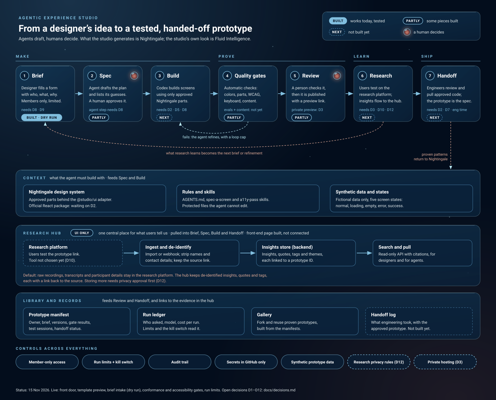

# Studio foundation



The diagram above shows the full lifecycle (brief, spec, build, gates, review, research, handoff), the layers that support it and what is built. A 2x PNG for slides is at [docs/architecture.png](../docs/architecture.png).

The platform half of the Agentic Experience Studio: the pieces that make agent-generated prototypes safe, checkable and reusable. It does not call any AI service yet.

| Folder | Purpose |
|---|---|
| `schemas/` | JSON Schema for the per-prototype manifest (`prototype.json`) |
| `context/` | Context pack for the agent: tokens, component catalog, usage guides. **Placeholders** until the design system source is confirmed |
| `gates/` | Deterministic quality gates. `conformance.mjs` fails on raw colors, inline styles and unapproved packages |
| `scripts/` | Manifest validation and the library index builder |
| `fixtures/` | A known-good and a known-bad prototype, used to prove the gates fail when they should |
| `prototypes/` | Where merged prototypes will live, one folder per prototype with a `prototype.json` |
| `template/` | Vite + React starter that prototypes begin from. It imports components only from `@studio/ui`, an adapter that holds **temporary approximations**, not official Nightingale components. `template/AGENTS.md` holds the agent's rules |
| `skills/` | Reusable agent instructions: `spec-a-screen` and `a11y-pass` |
| `config/` | Run limits (`limits.json`) and model prices (`pricing.json`). Protected: the agent must not be able to raise its own limits |

## Commands

```sh
cd studio
npm ci
npm test                 # gate and schema tests
npm run conformance -- <dir>   # check any source folder (default: the good fixture)
npm run validate         # validate prototypes/*/prototype.json
npm run build-index      # write dist/library-index.json
npm run spec -- check <spec.json>                   # validate a spec against the schema and approved catalog
npm run spec -- approval <spec.json> <approval.json> # confirm an approval matches the exact spec
cd template
npm ci
npx playwright install chromium   # first time only
npm run dev              # view at http://localhost:5173/?state=default
npm run typecheck && npm run conformance
npm run test:a11y        # builds, serves the build, runs axe on every state
```

The template's screen states are `default`, `loading`, `empty`, `error` and `success`, opened with `?state=<name>`. The accessibility gate visits every state, runs axe against the WCAG 2.0 to 2.2 A and AA tags, checks a keyboard path, and includes a self-test that a known-bad page is flagged. Automated results are "checked so far", not "compliant"; a manual accessibility pass is still required before publishing.

`template/src/ui/` is the platform-owned adapter and token layer (exempt from the raw-color rule, protected in CODEOWNERS). Prototype code goes in `template/src/screens/` and is fully checked. When the official Nightingale package is approved, re-export it from `src/ui/index.ts`.

## Hosting and the password prompt

The Pages deploy publishes the template at `/template-preview/` next to the front door. The site and repository are public, so only synthetic, non-sensitive content belongs there.

- The preview opens on a password prompt. The Pages workflow sets the demo password (`design123`, public in this repository) and the build embeds only its **SHA-256 hash** in the template preview, not the password itself.
- This is a deterrent, not security: it runs in the browser and can be bypassed, and a weak password can be guessed from the hash. The prompt says so. Real access control needs an authenticated host (decision D3).
- With no hash set (local `npm run dev`, tests of the open build), the app opens directly.
- Browser tests cover the prompt (`tests/gate.spec.ts`), including that the built bundle never contains the plaintext password.
- `src/gate/` is a platform entry point styled with the Fluid Intelligence guide, not Nightingale, and is exempt from the prototype conformance rules like `src/ui/`. Generated prototype code is not exempt.
- Per-PR previews are not hosted: Pages serves one site per repo. Run `npm run dev` locally, or download the CI build.

## Run records, limits and the kill switch

Every agent run gets one line in an append-only ledger (`runs/ledger.jsonl`, schema in `schemas/run.schema.json`): who asked, the phase, model, context-pack version, a hash of the prompt (not the prompt), token usage and cost.

```sh
npm run runs -- check --user <github-user>   # exit 1 if the run must not start
npm run runs -- record <run.json>            # validate and append a run record
npm run runs -- summary                      # month-to-date spend per designer
```

`check` blocks a run when the kill switch is off, the designer or the studio hit the daily limit, or the monthly budget is spent. Set `STUDIO_ENABLED=false` for an emergency stop without a commit. It fails closed: an unreadable ledger, an unknown requester or a model with no configured price all block the run.

Limits in `config/limits.json` are starting values to confirm with procurement (D5). Prices in `config/pricing.json` are empty until an owner adds approved models. A per-run cost cap is not implemented here; it belongs at agent invocation (token limits and timeouts) in the runner. Where the ledger lives in production (a repo file, a branch or an external store) and whether raw prompts are retained are open decisions for the runner and the governance review.

## Brief intake (dry run)

Designers start a job by opening an issue from the **Prototype brief (TADA)** form (`.github/ISSUE_TEMPLATE/tada-brief.yml`). The `Studio brief intake` workflow then, with no model call and no OpenAI key:

1. ignores anything that is not a new `[Brief]` issue;
2. rejects authors who are not the owner, a member or a collaborator (anyone can open an issue on a public repo);
3. validates the brief (required fields, length limits, https figma.com link, synthetic-data confirmation);
4. applies the run limits and kill switch from `config/limits.json`;
5. replies on the issue with the outcome. An accepted brief is labelled a dry run, because no agent is connected yet.

The issue body is untrusted: the script reads it from the event file as data and it is never placed in a shell command. Connecting Codex later means adding a job after step 4 that writes a spec, runs `npm run spec -- check`, and waits for an approval (see `skills/spec-a-screen`).

## Not built yet

Design evals, the Codex agent step (spec, approval, build) and per-PR preview hosting. These need the decisions in [docs/decisions.md](../docs/decisions.md).
